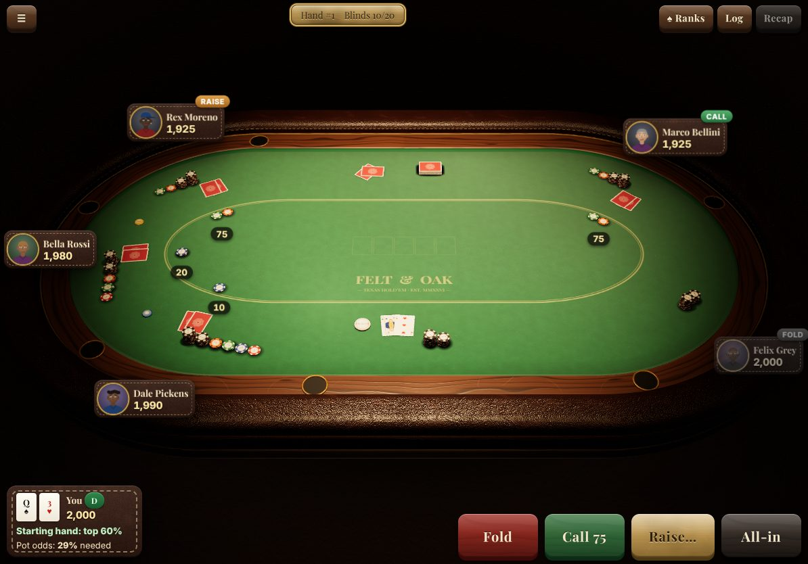
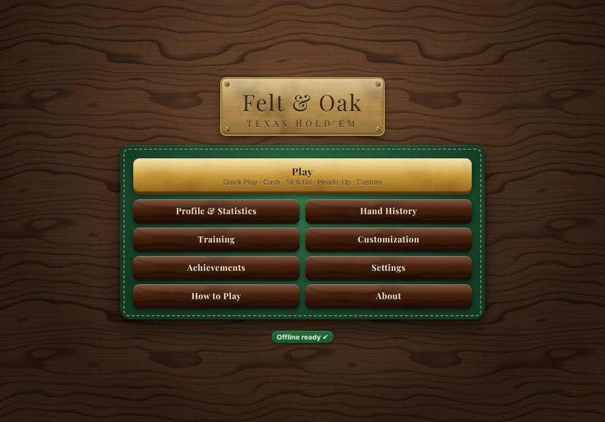
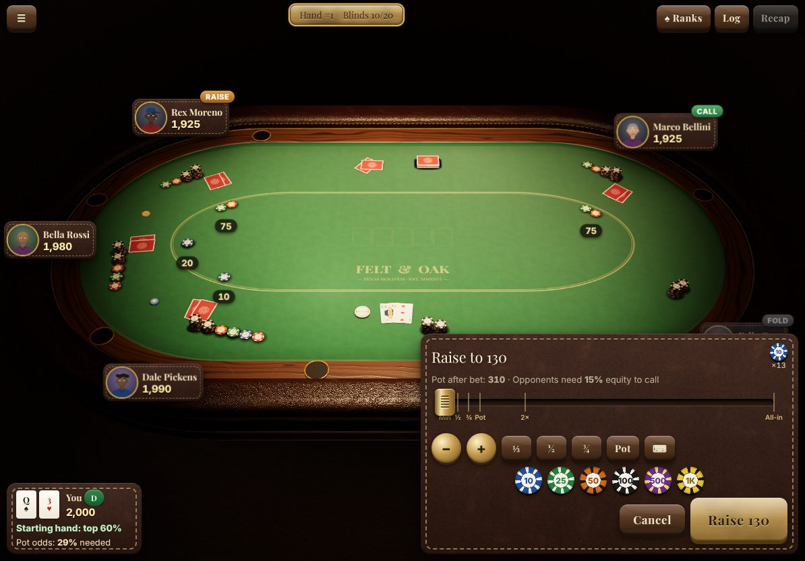
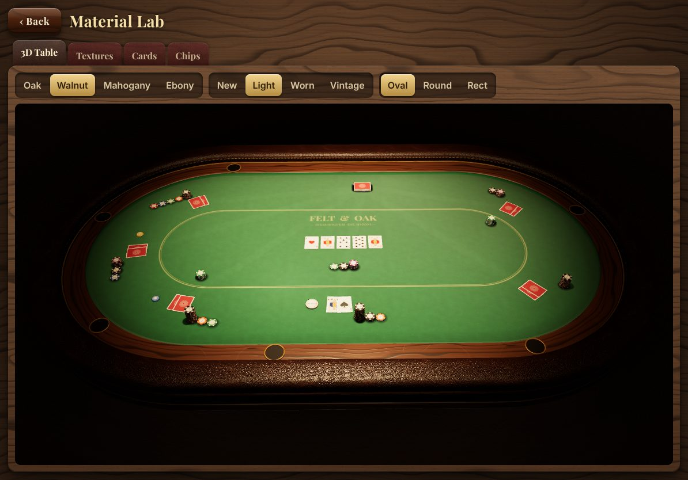
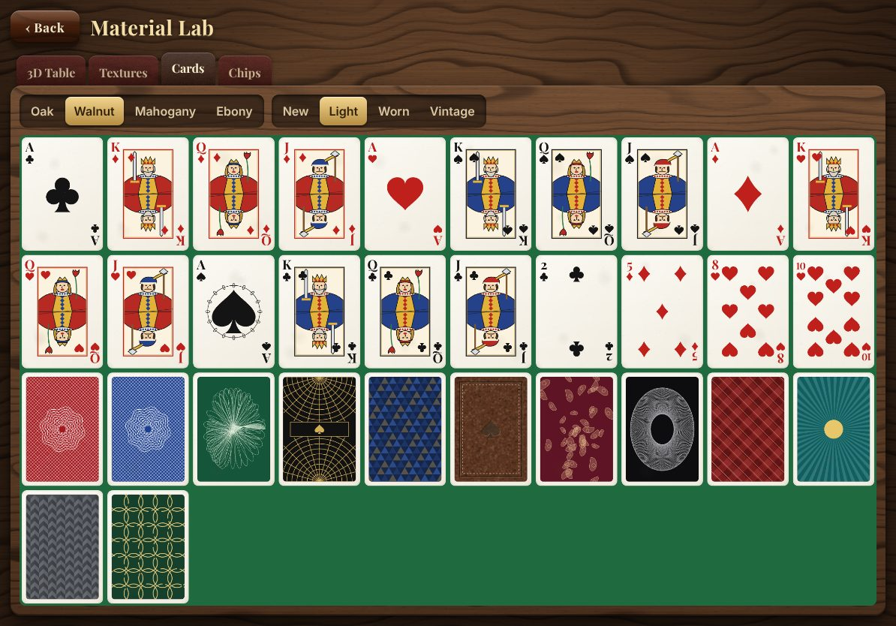
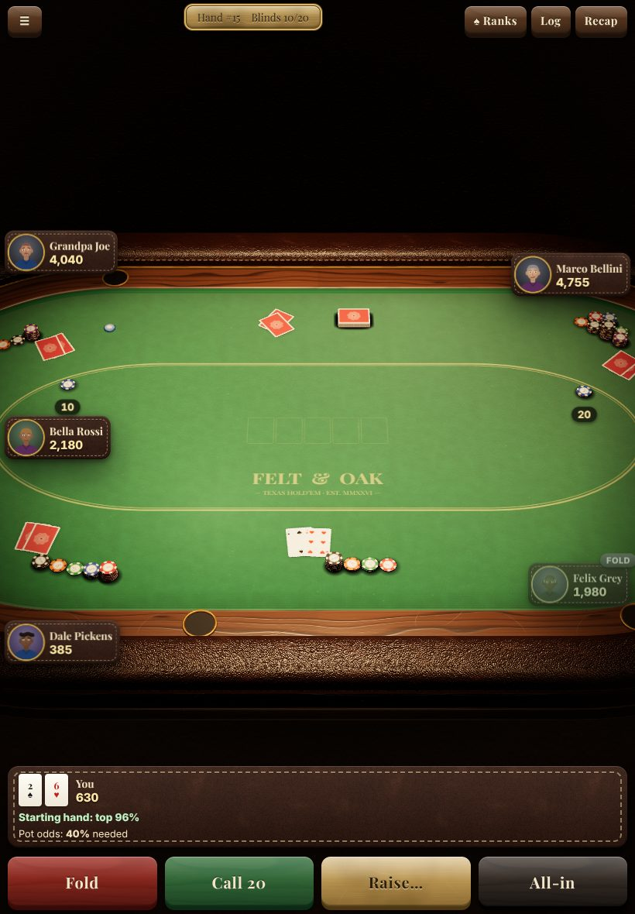
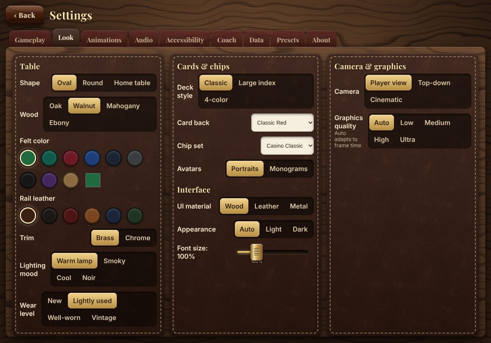

# Felt & Oak Hold'em

A fully **offline**, installable Texas Hold'em game (Progressive Web App) built for the **iPad Air 5 (M1) in Safari / iPadOS**,
with a skeuomorphic, slightly worn, physical-looking poker table rendered in 3D. Everything — textures, card faces,
chips, avatars, icons, sounds, music and the bots' brains — is generated or computed **on the device**. After the first
load the app never touches the network again.



| | |
|---|---|
|  |  |
|  |  |
|  |  |

---

## Contents

1. [Install on iPad (step by step)](#install-on-ipad)
2. [Offline verification checklist](#offline-verification-checklist)
3. [Troubleshooting](#troubleshooting)
4. [Backups](#backups)
5. [Hosting: GitHub Pages / Netlify / any sub-folder](#hosting)
6. [Development](#development)
7. [Testing & verification results](#testing--verification-results)
8. [Features](#features)
9. [Architecture](#architecture)
10. [Bot AI and simulator report](#bot-ai)
11. [Design decisions](#design-decisions)
12. [Known limitations](#known-limitations)

---

## Install on iPad

1. Connect the iPad to **Wi-Fi**.
2. Open **Safari** (it must be Safari — other iPad browsers cannot install web apps on older iPadOS versions) and go to the
   URL where the game is hosted, e.g. `https://<your-user>.github.io/<repo-name>/`.
3. Wait until the main menu appears. At the bottom you will see **“Preparing offline mode…”** change to **“Offline ready ✔”**
   (a few seconds — the app is downloading every file into its offline cache).
4. Tap the **Share** button (square with an arrow) → **Add to Home Screen** → **Add**.
5. Launch the game **from the new home-screen icon** (not from Safari). Installed web apps have their own storage on iPadOS.
6. In the app open **Settings → About** (or the main menu) and wait for **“Offline ready ✔”** again. This screen also shows
   the number of cached files, cache size and whether persistent storage was granted.
7. Turn on **Airplane Mode** (Control Center).
8. **Fully close** the app: swipe up from the bottom edge, pause, and swipe the app card away.
9. Tap the home-screen icon again → the game opens offline. Start a hand to confirm.

## Offline verification checklist

- [ ] Main menu shows **Offline ready ✔**.
- [ ] Settings → About → **Cached files** shows a number (≈ 45) and a size (≈ 1.6 MB).
- [ ] With Airplane Mode on and the app force-closed, the icon still launches the game.
- [ ] Quick Play deals cards, bots act, hands complete.
- [ ] Force-close in the middle of a hand, relaunch → **Continue Game** resumes the exact same hand.
- [ ] Settings → Data → **Export backup** works (Share sheet → Save to Files).

## Troubleshooting

| Symptom | Fix |
|---|---|
| “Offline ready” never appears | Stay online on the main menu for ~30 s. Make sure you are not in a Private Browsing tab. Reload once. |
| The icon opens a blank page offline | You probably installed the app **before** it finished caching. Go online, open the app from the icon, wait for “Offline ready ✔”, then test offline again. |
| Offline works in Safari but not from the icon | The home-screen app has its **own** storage. Open the icon once while online and wait for “Offline ready ✔”. |
| “New version available – Reload” appears | A new build was deployed. Tap **Reload** while online; the new version is cached automatically. |
| Everything is gone after months of not playing | iPadOS may evict storage of web apps that are not used for a long time. Restore your **backup** (Settings → Data → Import). Reinstall the app from the URL if needed. |
| Hosted in a sub-folder and assets 404 | Make sure you deployed the `dist/` folder as built (all paths are relative). Do not rewrite `/assets/*` to another location. |
| Still stuck | Settings (iPad) → Safari → Advanced → Website Data → remove the site, reinstall following the steps above. |

## Backups

iPadOS can delete the data of web apps that haven't been opened for a long time. The game calls
`navigator.storage.persist()` (status shown in Settings → About) and keeps everything in IndexedDB (with a
localStorage fallback), but **export a backup now and then**: Settings → Data → **Export backup** creates a JSON file
(settings, profile & statistics, achievements, saved game, presets and up to 500 hands of history). On iPad, choose
**Save to Files** (iCloud Drive) in the share sheet. **Import backup** restores it. The main menu shows a “Last backup”
reminder after 14 days.

## Hosting

The build is **sub-folder safe**:

- Vite `base: './'` → every script, style, font, worker and icon URL in the build is relative.
- The manifest uses `start_url: "./"`, `scope: "./"`, `id: "./"` and relative icon paths.
- The service worker is registered relative to the page and precaches relative URLs; navigation falls back to `index.html`.
- No absolute paths (`/assets/x.png`) appear anywhere in code or CSS.

So the same `dist/` works at `https://example.com/`, `https://user.github.io/repo-name/` or `https://example.com/games/poker/`.

### GitHub Pages

`.github/workflows/deploy.yml` builds, type-checks, runs unit tests and the offline E2E test, then deploys `dist/` to Pages.

1. Push the repository to GitHub (default branch `main`).
2. Repository **Settings → Pages → Build and deployment → Source: GitHub Actions**.
3. Push to `main` (or run the workflow manually). The site appears at `https://<user>.github.io/<repo>/`.

### Netlify

`netlify.toml` is included (build `npm run build`, publish `dist`, `sw.js` served with `no-cache`).
Either connect the repo in the Netlify UI, or: `npm run build && npx netlify deploy --prod --dir=dist`.

Any static host works; serve `sw.js` without long-term caching so updates are detected.

## Development

```bash
npm install
npm run dev            # dev server (service worker disabled in dev)
npm run build          # icons + production build into dist/
npm run preview        # serve dist/ on http://localhost:4173
npm test               # unit tests (Vitest)
npm run test:e2e       # Playwright: offline, resume, screenshots (needs `npm run build` first)
npm run simulate       # bot-vs-bot simulator (50,000 hands by default)
npm run lighthouse     # Lighthouse v11 against a running `npm run preview`
npm run typecheck
```

Node 20+ (tested with Node 22). Playwright uses Chromium; set `PW_CHROMIUM` to a Chromium binary if you don't want to
`npx playwright install chromium`.

## Testing & verification results

| Check | Result |
|---|---|
| Unit tests (Vitest) | **39 passing** — evaluator vs brute-force reference (property-based with fast-check), 6,000 random hands (chip conservation, no negative stacks, no deadlocks, replay equality), side pots, min-raise & incomplete all-in reopening, odd chip, run-it-twice, straddle, PL/FL limits, table rotation, heads-up transition, multi-way all-ins, bust-outs & places, bot legality across all archetypes/difficulties, **bots never see other hole cards**, equity sanity, chip change-making, settings migration, backup validation |
| `offline.spec.ts` | ✅ installs, waits for the SW, goes **offline**, reloads, menu renders, About shows “Offline ready” + cached files, a Quick Play hand is dealt and played, reload offline → Continue Game; **fails on any request to a non-local origin** (none made) |
| `offline-shell.spec.ts` | ✅ offline navigation, settings, `./index.html` served from cache |
| `resume.spec.ts` | ✅ app killed mid-hand → Continue Game restores the identical hand (hand id, hole cards, stacks, action count) |
| `screenshots.spec.ts` | renders all menus, settings tabs, Material Lab (woods, wear, shapes, cards, chips, textures) and the game in landscape & portrait into `screenshots/` |
| Lighthouse 11 (desktop, software GPU) | see table below |
| Bot simulator | Expert > Hard > Medium > Easy > Beginner (see report) |

### Lighthouse (v11) results

| Category | Score |
|---|---:|
| Performance | 68 |
| Accessibility | 100 |
| Best Practices | 100 |
| PWA | 100 |

**PWA audits**

- ✅ Web app manifest and service worker meet the installability requirements
- ✅ Configured for a custom splash screen
- ✅ Sets a theme color for the address bar.
- ➖ Content is sized correctly for the viewport
- ✅ Has a `<meta name="viewport">` tag with `width` or `initial-scale`
- ✅ Manifest has a maskable icon

Notes: Performance is measured in a headless VM with a *software* GPU (SwiftShader) where rasterizing the textured CSS
and WebGL is CPU-bound; on the iPad's GPU the same work is negligible. 

## Features

**Table & visuals** — oval, round and rectangular home-game tables with 2–9 seats; solid oak / walnut / mahogany / ebony
with procedural grain, rings, knots, pores, varnish clear-coat, scratches and glass ring marks; padded leather rail with
pebble grain, creases and stitching; brass or chrome trim; cup holders; speed-cloth felt with directional fibers, printed
betting line and logo, ambient occlusion along the rail, wear patches in front of each seat and the dealer, card-slide
marks and chalk dust; 9 felt colors + custom picker, 6 leather colors; hanging lamp with a warm pool of light, soft
shadows, contact shadows that grow and fade with height, vignette, procedural environment map for reflections; four
lighting moods (warm lamp, smoky, cool, noir); 4 wear levels applied consistently to wood, felt, leather, metal, cards and
chips; quality presets Low/Medium/High/Ultra + Auto (frame-time based downgrade). Ultra adds an edge depth-of-field.

**Cards** — original, procedurally drawn faces (pips, Ace of Spades ornament, double-headed court figures for J/Q/K),
classic / large-index / 4-color decks, rounded corners, glossy clear-coat, wear (corner scuffs, nicks, smudges), and
12 card backs (classic red/blue, guilloche, art-deco, geometric, embossed leather, paisley, rosette, diamond lattice,
sunburst, herringbone, Celtic knot).

**Chips** — clay chips with bevelled rims, edge spot inserts, embossed inlay with denomination (1 … 100K), 4 chip sets,
imperfect stacks, glossy clear-coat.

**Animations** (all respect Animation Speed Off/0.5×/1×/1.5×/2×/Instant and Reduce Motion; tap the felt to skip):
riffle, bridge (bent cards arch and cascade), table-top overhand/strip, wash/scramble and cut shuffles before every hand;
dealing one card at a time from left of the button with ballistic flicks that land short and slide to rest with friction
(or a slide-deal style); burn cards; flop dealt as a packet, flipped and spread; turn and river flips with an optional
slow-rolled river (corner peel); corner **peek** of your hole cards with real card bending (touch and hold) and tap to
reveal; folds tossed with spin into the muck; showdown flips; winning five cards lift and glow, the rest dim; all cards
swept back, stacked and squared. Chips: bets picked from the stack and tossed with gravity, bounce and wobble-settle;
all-in pushes; dramatic splashes; change-making at the dealer's tray when you don't have the right chips; bets swept into
the pot; side pots as separate piles; payouts pushed to the winners, split pots divided physically; colour-ups of large
piles; idle fidgeting while bots think; rolling stack numbers. Cinematic camera zoom on big all-ins and showdowns.

**Betting controls** — physical Fold / Check / Call / Bet-Raise / All-in buttons; bet panel with a brass slider
(detents at Min, ⅓, ½, ⅔, ¾, Pot, 2× Pot, All-in), chip buttons that add chips (tap preview chips to remove), ± with
configurable step (BB, ½BB, 1, custom), a tactile keypad, live chip preview, opponents' price (pot odds) and min-raise
legality; pre-action toggles (Check/Fold, Check, Call any); optional turn timer.

**Rules engine** — No-Limit, Pot-Limit, Fixed-Limit; blinds, antes, straddle, correct heads-up order, min-raise, incomplete
all-ins not reopening action, side pots, uncalled-bet returns, odd-chip rule, showdown order (last river aggressor first),
auto-muck, run it twice (off/ask/always); crypto-random Fisher–Yates shuffle (seeded mode for tests/replays); fully
event-sourced hands (init + actions) for persistence, export and replay.

**Modes** — Quick Play, Cash Game (rebuy/top-up, bots join/leave, add/remove seats between hands), Sit & Go (blind
levels by hands or minutes, configurable payouts), Heads-Up Duel, Custom Game (every parameter, per-seat bots).

**Bots** — see [Bot AI](#bot-ai).

**Screens** — main menu with Continue Game, Profile & Statistics (VPIP, PFR, 3-bet, WTSD, W$SD, AF, bb/100, biggest pot,
best hand, streaks, SnG record, per-opponent records, hand-drawn SVG bankroll chart), Hand History (last 500 hands,
export JSON & text) with step-through Replay, Training (tutorial, preflop, pot-odds and outs trainers, spot review of
coach-flagged mistakes), Achievements (16 with progress), How to Play, Settings (Gameplay, Look, Animations, Audio,
Accessibility, Coach, Data, Presets, About), Material Lab (live 3D table + every generated texture, card and chip).
In game: pause menu, hand-rank cheat sheet, action log, last-hand recap with coach review, optional coach (pot odds,
outs, equity meter, suggested action with explanation), opponent HUD and bios.

**Audio** — synthesized live with Web Audio: card flick/slide/land/flip, riffle, bridge, wash, square-up, ceramic chip
clacks scaled by count, stack settle, chips sliding, wood knock for check, fold thud, FM bell for blind levels, timer
warning, win fanfare, UI clicks (press/release, switch, slider detents, tabs), procedural room reverb, stereo panning by
seat, and optional generative lounge music (FM electric piano, walking bass, brushes).

**Accessibility** — VoiceOver labels on every control and seat, live region announcing actions, colour-blind (4-colour)
deck, high-contrast text, larger tap targets, left-handed layout, reduce motion, font size, keyboard shortcuts
(F/C/R/A/Esc).

## Architecture

```
src/
  engine/     cards, crypto/seeded RNG, 7-card evaluator, NL/PL/FL hand state machine, table/tournament manager
  ai/         preflop table (generated), ranges & Monte Carlo equity, brain (decisions), opponent model, characters
  workers/    ai.worker (bot decisions & equity off the main thread), texture.worker (procedural textures)
  scene/      Three.js TableScene, table geometry, materials, procedural textures, card/chip instancing,
              camera rig, animation runtime & physics, Director (choreography), Material Lab demo
  state/      settings (versioned + migrations), game controller, modes, profile/stats/achievements, lifecycle
  storage/    IndexedDB with localStorage/memory fallback, backups, hand history
  audio/      Web Audio synthesizer
  ui/         Preact screens and the skeuomorphic UI kit
scripts/      gen-icons (PNG encoder + procedural icon), gen-preflop (169-hand equity table), simulate, lighthouse,
              texture preview, screenshot helpers
tests/        unit (Vitest) and e2e (Playwright)
```

Key implementation notes:

- **All cards are one `InstancedMesh`** (one draw call) with a custom shader: per-instance face index selects a cell in a
  2048² atlas, per-instance bend parameters curl a corner (peeks, riffles, bridge), glow/dim for showdowns. All chips are
  another `InstancedMesh` with per-instance denomination selecting cap/edge art from a chip atlas. Contact shadows are two
  more instanced meshes. The table is ~10 draw calls.
- **Physics** is analytic and deterministic: a flicked card is solved so that its ballistic flight lands short of the
  target and the friction slide (μ·g deceleration) stops exactly on it; chips follow lift-carry-drop arcs, then gravity
  with restitution and a damped wobble; slides decelerate uniformly; stacks sway by height. Animations run on a
  time-scaled clock so speed settings, Reduce Motion and tap-to-skip all work, and the game state never depends on them.
- **Render on demand**: frames are drawn only while something moves (or the idle camera sway is enabled); rendering is
  paused when the page is hidden; WebGL context loss is handled and restored; DPR is capped per quality preset; Auto
  quality steps down when the median frame time exceeds 24 ms.
- **Procedural textures** (fractal noise, domain-warped wood rings, cellular leather, anisotropic brushed metal, felt
  fibers, paper, clay, scratch and wear masks, normal and roughness maps) are pure functions run in a Web Worker,
  encoded to PNG and cached in IndexedDB, so subsequent launches are instant. Texture sizes are ≤ 2048 px.
- **Persistence**: the controller saves after every action and on `visibilitychange`/`pagehide`; a hand is stored as its
  `HandInit` + action list and replayed on resume. Saves are versioned; settings are merged onto defaults and migrated.

## Bot AI

Layered decision system (all local, in a Web Worker; bots only receive a `BotView` with public information and their own
two cards — a unit test asserts that no other hole cards are present):

1. **Math layer** — 169-hand preflop table generated by Monte Carlo (heads-up and multi-way equity), opening ranges by
   number of players left to act (adapts to table size), 3-bet/4-bet/squeeze/iso-raise/limp logic, short-stack
   push/fold, ICM-style bubble tightening; postflop **Monte Carlo equity against estimated ranges** (ranges are narrowed
   from every observed preflop and postflop action, weighted by hand strength and draws on the board), pot odds,
   implied and reverse-implied odds, SPR, MDF on the river, outs/draws, blockers, board texture (wet/dry, paired,
   monotone, connected).
2. **Strategy layer** — mixed strategies with randomness everywhere, value bets (thin and thick), protection bets,
   c-bets adjusted for texture and the opponents' fold-to-c-bet, barrels, probe bets, traps and slow-plays,
   check-raises, semi-bluffs, balanced river bluffs chosen with blockers and fold equity, occasional polar overbets,
   bluff-catching by MDF, hero folds versus tight players, sizing tied to texture and hand type.
3. **Opponent modelling** — VPIP, PFR, 3-bet, fold-to-3-bet, c-bet, fold-to-c-bet, AF, WTSD, W$SD, check-raise tracked per
   player with Bayesian smoothing; Medium and above exploit them (Expert fully).
4. **Personality** — archetypes TAG, LAG, Rock, Calling Station, Maniac, Nit, Balanced Pro, Tourist, Trickster with
   consistent parameters; tilt and confidence after big wins/losses; human-like think times (longer for close decisions,
   jitter, “Hollywooding” and quick-call timing tells only for weak bots), sizing tells for Beginner/Easy, chip fidgeting
   while thinking, optional table talk, 18 named characters with procedurally drawn portraits and bios.
5. **Difficulty** — Beginner, Easy, Medium, Hard, Expert differ in Monte-Carlo budget, equity noise, range reading,
   respect for pot odds, bluff selection quality, exploitation and controlled mistake rate; **Adaptive** picks the level
   from your results; **Mixed Table** seats a spread of levels.

### Simulator report

`npm run simulate` (`scripts/simulate.ts`) plays headless 6-max No-Limit hands (100 bb deep, stacks reset every hand) on
worker threads and reports bb/100. Latest run:

Run: 50,000 hands (difficulty ladder, mixed archetypes TAG/Pro/LAG/Rock/Station) + 25,000 hands (archetypes, all Medium), 6-max NL, 100bb deep, 76s on 4 threads. Errors: 0.

**By difficulty (bb/100)**

| Difficulty   |   bb/100 | hands    |
|--------------|---------:|---------:|
| beginner     |   -131.6 |    60000 |
| easy         |    -56.5 |    60000 |
| medium       |     20.6 |    60000 |
| hard         |     69.4 |    60000 |
| expert       |     98.0 |    60000 |

**By archetype at Medium difficulty (bb/100)**

| Archetype    |   bb/100 | hands    |
|--------------|---------:|---------:|
| TAG          |     53.7 |    16480 |
| LAG          |     27.9 |    16640 |
| Rock         |     66.6 |    16800 |
| Station      |   -159.1 |    16840 |
| Maniac       |    -21.7 |    16840 |
| Nit          |     55.2 |    16840 |
| Pro          |     72.5 |    16680 |
| Tourist      |   -101.8 |    16520 |
| Trickster    |      7.2 |    16360 |

## Design decisions

- **Preact + Three.js, no physics engine**: the analytic solver gives exactly-on-target, believable motion at a fraction of
  the cost of a general engine (important for a 60 fps budget on iPad and for deterministic resume).
- **Textures generated at first launch** (in workers, cached as PNG blobs in IndexedDB) instead of shipping images: the
  install stays ≈ 1.6 MB, and wear level / colors can be regenerated on demand. Icons are generated at build time by a
  dependency-free PNG encoder.
- **Fonts** (Playfair Display, Inter — SIL OFL) are bundled from npm as woff2 and precached.
- **Workbox `generateSW`** via `vite-plugin-pwa` with `globPatterns` covering every emitted file type (JS chunks, worker
  chunks, CSS, fonts, icons, HTML, manifest) → nothing can be missed. `cleanupOutdatedCaches`, navigation fallback,
  prompt-to-update flow (“New version available – Reload”).
- **Human seat is always bottom-center**; the dealer sits at the top (or at the side for heads-up). Seat positions are
  distributed by arc length around the table outline, so any shape and seat count works.
- **Camera framing** is solved numerically: the radius and look-at point are binary-searched so the whole table plus name
  plates fit between the top bar and the action bar for any aspect ratio (landscape, portrait, Split View).
- **Hole cards land face down**; peek by holding, tap to flip, and they flip automatically the first time you must act.
- **Bots join/leave** between hands in cash games (a busted bot rebuys or is replaced by a new character).

## Known limitations

- **Haptics**: iPadOS Safari does not support the Vibration API; feedback is audio + visual (button press animation).
- **Audio** can only start after the first touch (WebKit autoplay policy); the app unlocks audio on the first tap.
- **Storage eviction**: iPadOS may clear web-app data after long inactivity even with `persist()`; use backups.
- **`user-scalable=no`** is not used (iOS ignores it); page zoom is prevented with gesture handlers and `touch-action`.
- **Lighthouse PWA category** was removed in Lighthouse 12, so the project pins Lighthouse 11 for the PWA audit. The
  “content is sized correctly” audit is not applicable in desktop mode.
- **Headless verification** uses software WebGL, which is slow; automated tests set animations to instant
  (`window.__speedOverride = 0`) — the same code paths run, just without waiting.
- The table-top **overhand** shuffle is performed as a strip shuffle on the felt (a real overhand happens in the air).
- Run it twice requires all players in the hand to agree; bots agree about 60% of the time.
- The opponent-record “net” per opponent is an approximation (chips you won from or lost to that player's stack).
